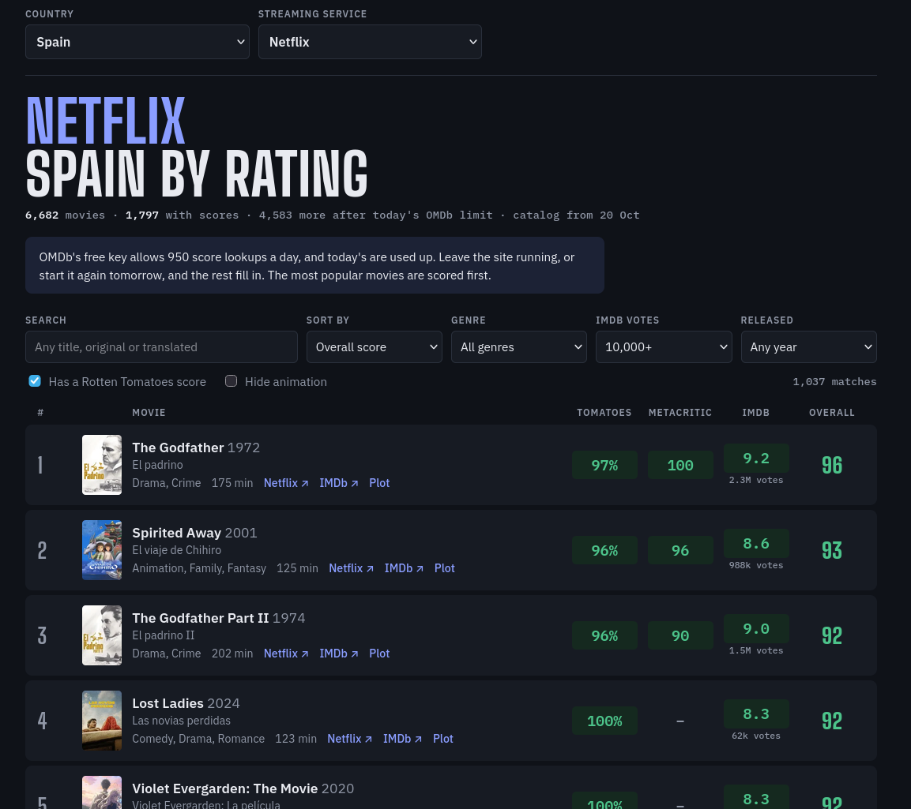

# Streaming by Rating

Every movie on a streaming service in your country, ranked by what critics think.

Netflix and the other services group their catalogs into rows picked by an algorithm, so there's no easy way to see everything that's available or sort it by quality. Streaming by Rating is a small website that runs on your own computer. Pick a country and a service, and it lists every movie available there with its **Rotten Tomatoes**, **Metacritic** and **IMDb** scores, sorted best first.



## Features

- **Any country, any service.** Choose from every country and streaming service that TMDB tracks: Netflix, Prime Video, Disney+, Max, Filmin, and many more.
- **Three critic scores and an overall score.** The overall score is the average of the Rotten Tomatoes critics score, the Metascore, and the IMDb rating × 10.
- **Filters.** Search by title (original or translated), and filter by genre, release year, a minimum number of IMDb votes, and whether a movie has a Rotten Tomatoes score.
- **Stays up to date.** Catalogs refresh once a day, so movies that leave a service disappear and new arrivals show up.
- **One file, no dependencies.** It's a single Python script that uses only the standard library.
- **Private.** Your API keys and data stay on your computer, and the site only accepts connections from your own machine.

## Requirements

- Python 3.8 or newer
- A free [TMDB](https://www.themoviedb.org/) API key, for the catalogs
- A free [OMDb](https://www.omdbapi.com/) API key, for the scores

## Getting the API keys

**TMDB:** create an account, then go to [Settings → API](https://www.themoviedb.org/settings/api) and request a key. Choose **Personal** use. Either the "API Key" or the "API Read Access Token" works.

**OMDb:** request a free key at [omdbapi.com/apikey.aspx](https://www.omdbapi.com/apikey.aspx). It arrives by email and has to be activated through the link in that email.

## Usage

```bash
python3 streaming_ratings.py
```

On Windows, use `python streaming_ratings.py`.

The first time, the script asks for both keys and saves them in `config.json`. Your browser then opens [http://localhost:8000](http://localhost:8000). Keep the terminal window open while you use the site, and press `Ctrl+C` to stop it.

| Option | What it does |
| --- | --- |
| `--port 8123` | Runs the site on another port |
| `--no-open` | Doesn't open the browser automatically |

## How it works

1. **Catalog.** The script asks [TMDB](https://www.themoviedb.org/) for every movie on the chosen service in the chosen country. TMDB's availability data comes from [JustWatch](https://www.justwatch.com/).
2. **Details.** For each movie it fetches the English title, genres, runtime and IMDb ID from TMDB.
3. **Scores.** It looks up the Rotten Tomatoes, Metacritic and IMDb scores for each IMDb ID through [OMDb](https://www.omdbapi.com/).
4. **Page.** The site shows the list and updates it live as scores come in.

Everything is cached in a `data` folder next to the script:

- **Catalogs** refresh in the background once a day.
- **Movie details** are kept for 90 days.
- **Scores** are kept for 30 days, then refreshed. They're shared between all countries and services, so a movie is only looked up once.

### About the daily limit

OMDb's free key allows **1,000 lookups a day**. A big catalog has several thousand movies, so the **first time** you open a new country and service, it takes a few days for every movie to get scores. The most popular movies are scored first, and scoring only runs while the site is open, for the country and service currently selected.

After that, only new arrivals need lookups, usually a few dozen a week, so the list stays current within minutes of each refresh. If you want new catalogs scored right away, OMDb's paid tiers raise the limit.

## Settings

`config.json` is created on the first run:

```json
{
  "tmdb_key": "…",
  "omdb_key": "…",
  "omdb_daily_budget": 950,
  "port": 8000,
  "last_country": "ES",
  "last_service": 8
}
```

- `omdb_daily_budget` is how many OMDb lookups the site makes per day. It's set a little under the free limit of 1,000, so you have some left over. Raise it if you have a paid key.
- `last_country` and `last_service` remember your last choice, and the site reopens on them.

## Keep your keys out of Git

`config.json` contains your API keys, and `data/` is a local cache. Add both to `.gitignore`:

```gitignore
config.json
data/
```

## Known limitations

- Availability comes from TMDB/JustWatch and can lag behind the services by a day or two.
- TMDB returns at most 10,000 movies for each service and country. Only the very largest catalogs reach that.
- Some movies have no Rotten Tomatoes or Metacritic score, especially older, regional or very new ones. Untick **Has a Rotten Tomatoes score** to see them.
- Only movies are included, not TV series.

## Credits

- Catalog and movie data: [TMDB](https://www.themoviedb.org/). This product uses the TMDB API but is not endorsed or certified by TMDB.
- Streaming availability: [JustWatch](https://www.justwatch.com/), through TMDB.
- Scores: [OMDb API](https://www.omdbapi.com/).
